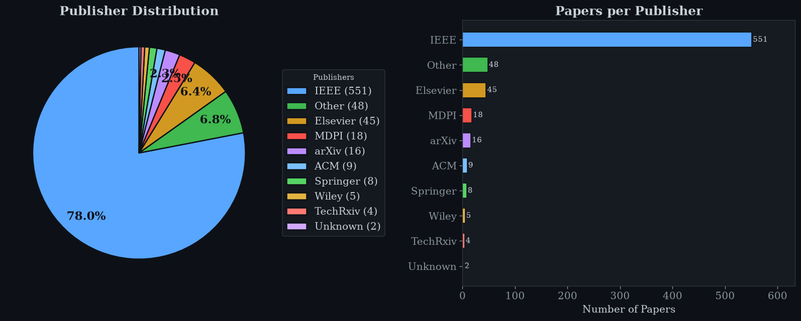
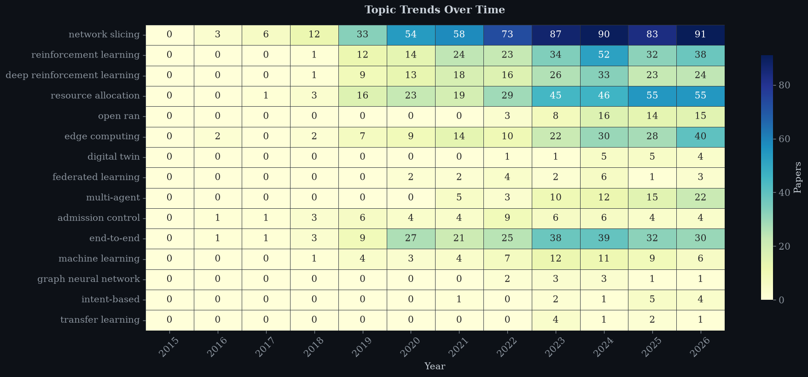
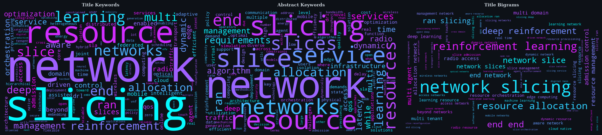
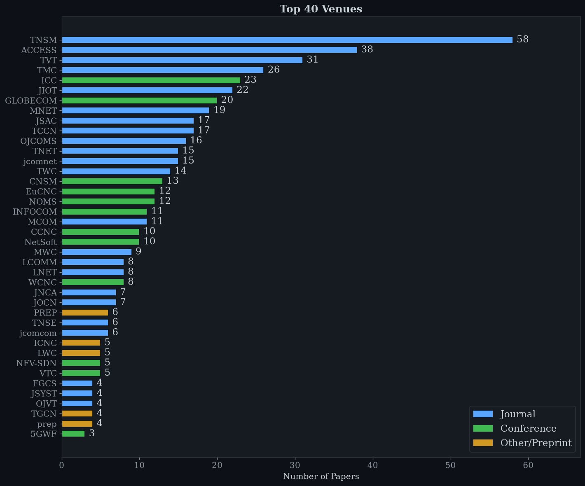

# 📚 litsuite: a literature library suite for researchers

Keep the papers of one or more research areas organised, cataloged and up to date:

- **Catalog** a folder of PDFs (on your computer or in OneDrive, Google Drive, Dropbox, iCloud, Box, or any cloud supported by rclone) into a CSV with DOI, abstract, venue, year and first author.
- **Update** that catalog when you add, rename, move or delete PDFs. Your manual edits are kept.
- **Discover** new papers from email alerts (Google Scholar, ScienceDirect, IEEE Xplore, ACM, Springer/Nature, Wiley, MDPI, arXiv), score them against *your* keywords and *your* existing library, and **download** the relevant ones automatically: open-access copies first, otherwise through your university sign-in.
- **Rename** every new PDF with your naming convention and your abbreviations, e.g. `MNET 25 Fryganiotis - Model_Predictive_Control-Based_Dynamic_Resource_Allocation_Enabler_for_Resilient_NS.pdf`.
- **Analyse** a collection with an 11-section dashboard notebook.
- Keep **several research areas separate** (projects), each with its own folder, catalog, keywords and abbreviations.

It works on Windows, macOS and Linux, for any discipline.


> **Looking for the original network-slicing scripts?** The single-purpose v1 toolkit
> (`literature_catalog.py`, `fill_abstracts.py`, dashboard) is preserved on the
> [`network-slicing-v1`](../../tree/network-slicing-v1) branch and the `v1.0-network-slicing` tag.
> The two script names still work here as thin wrappers around the new commands.

| Publisher Distribution | Topic Trends Heatmap |
|:---:|:---:|
|  |  |

---

## Contents

1. [Install](#1-install)
2. [Five-minute start: catalog a folder](#2-five-minute-start-catalog-a-folder)
3. [The settings file and projects](#3-the-settings-file-and-projects)
4. [Where your PDFs live (local and cloud folders)](#4-where-your-pdfs-live-local-and-cloud-folders)
5. [Creating and updating a catalog](#5-creating-and-updating-a-catalog)
6. [Naming convention and abbreviations](#6-naming-convention-and-abbreviations)
7. [Keywords and relevance scoring](#7-keywords-and-relevance-scoring)
8. [Email alerts: from inbox to renamed PDF](#8-email-alerts-from-inbox-to-renamed-pdf)
9. [Connecting your email accounts](#9-connecting-your-email-accounts)
10. [Institutional access to paywalled PDFs](#10-institutional-access-to-paywalled-pdfs)
11. [Running it automatically](#11-running-it-automatically)
12. [The analysis dashboard](#12-the-analysis-dashboard)
13. [Command reference](#13-command-reference)
14. [Where everything is stored (and what is private)](#14-where-everything-is-stored-and-what-is-private)
15. [Troubleshooting](#15-troubleshooting)
16. [Project structure, tests and data sources](#16-project-structure-tests-and-data-sources)

---

## 1. Install

You need **Python 3.9 or newer** ([python.org](https://www.python.org/downloads/); on Windows tick *"Add python.exe to PATH"*).

**Easiest: the install script** (creates a virtual environment, installs everything, downloads the browser used for institutional downloads, and copies the example settings):

```bash
git clone https://github.com/sinaebrahimi/network_slicing_literature_analysis.git
cd network_slicing_literature_analysis

bash scripts/install.sh                                         # macOS / Linux
powershell -ExecutionPolicy Bypass -File scripts\install.ps1    # Windows
```

**Or by hand:**

```bash
python -m venv .venv
source .venv/bin/activate          # Windows: .\.venv\Scripts\Activate.ps1
pip install -e ".[all]"            # or: pip install -r requirements.txt && pip install -e .
python -m playwright install chromium
```

Check the installation at any time:

```bash
litsuite doctor            # what is installed and configured
litsuite doctor --online   # also checks that CrossRef, Semantic Scholar, OpenAlex, Unpaywall, arXiv are reachable
```

> In every new terminal, activate the environment first (`source .venv/bin/activate` or
> `.\.venv\Scripts\Activate.ps1`). `python -m litsuite ...` works the same as `litsuite ...`.
> Run `litsuite` with no arguments for an interactive menu.

Minimal install (catalog + alerts over IMAP only): `pip install -e .`. Optional parts are
`[browser]` (institutional downloads), `[google]` (Gmail API, Google Drive), `[microsoft]`
(Outlook, OneDrive), `[dropbox]`, `[keyring]`, `[dashboard]`.

---

## 2. Five-minute start: catalog a folder

No settings file is needed for this:

```bash
litsuite catalog create
```

You will be asked:

1. **Which folder holds your PDFs?** Paste a path, e.g. `C:\Users\me\OneDrive - University\PhD\Literature` or `~/Documents/Literature` (quotes from Windows "Copy as path" are fine).
2. **Include PDFs from subfolders?** If the folder has subfolders, they are listed with their PDF counts, e.g. `Surveys (23 PDFs)`. Answer `a` (all), `n` (top level only) or `s` (choose each one).

The catalog is written to `litreview.csv` in the current folder (choose another with `--output`).
Everything can also be given as options, so nothing is asked:

```bash
litsuite catalog create --folder "D:/Papers/Literature" --recursive --exclude _old --output my_catalog.csv
```

Later, after you have added PDFs to the folder:

```bash
litsuite catalog update --folder "D:/Papers/Literature" --output my_catalog.csv
```

Only the new files are looked up. For a permanent setup with keywords, alerts and several
research areas, continue with the settings file.

---

## 3. The settings file and projects

All configuration lives in **one YAML file**, `config/settings.yaml`:

```bash
litsuite init                                            # guided: asks a few questions and writes it
cp config/settings.example.yaml config/settings.yaml     # or start from the fully commented example
```

[`config/settings.example.yaml`](config/settings.example.yaml) explains every option. It is
already filled in for the `network_slicing` project. `config/settings.yaml` is in
`.gitignore`, so your paths and email addresses are never pushed. **Passwords and tokens are
never written to it** (see [section 14](#14-where-everything-is-stored-and-what-is-private)).

A **project** is one research area. Each project has its own PDF folder, catalog, keywords,
abbreviations and alert settings, so different disciplines never mix:

```yaml
projects:
  network_slicing:
    library: "{onedrive_business}/PhD/Literature"
    recursive: true
    abbreviations: [config/abbreviations/network_slicing.yaml]
    keywords:
      focus: [network slicing, resource allocation, multi-agent reinforcement learning]
      secondary: [deep reinforcement learning, O-RAN, admission control, 6G, digital twin]
    alerts:
      accounts: [uni-outlook]

  protein_design:                       # a second, unrelated area
    library: "gdrive:/Papers/Protein"
    abbreviations: [config/abbreviations/general.yaml]
    keywords:
      focus: [protein design, structure prediction]
    alerts:
      accounts: [personal-gmail]
```

Choose the project with `-p/--project` on any command (`litsuite catalog update -p protein_design`).
With a single project defined, `-p` can be omitted; with several, litsuite asks.
`litsuite projects` lists them and checks the settings.

Each project's working files go to `projects/<name>/` (catalog, reports, backups).

Paths in the settings file may use `~`, environment variables (`$HOME`, `%USERPROFILE%`) and
the cloud placeholders below. Relative paths are relative to the repository folder.

---

## 4. Where your PDFs live (local and cloud folders)

The `library:` setting (or `--folder` on the command line) accepts any of these:

| `library:` value | What it means | Sign-in |
|---|---|---|
| `C:/Users/me/Papers`, `~/Papers` | a folder on this computer (Windows, macOS, Linux) | none |
| `{onedrive}/PhD/Literature` | inside the **OneDrive** desktop-sync folder on *whatever computer you are on* | none |
| `{onedrive_business}/...`, `{onedrive_personal}/...` | the work/school or personal OneDrive folder specifically | none |
| `{gdrive}/Papers` | inside the **Google Drive for desktop** folder (`My Drive`) | none |
| `{dropbox}/Papers`, `{icloud}/Papers`, `{box}/Papers` | Dropbox / iCloud Drive / Box desktop folders | none |
| `dropbox:/Research/Literature` | Dropbox through its API (no desktop app needed) | `litsuite login cloud dropbox` |
| `gdrive:/Research/Literature` or `gdrive:id:<folderId>` | Google Drive through its API (path from *My Drive*, or a folder ID, shared drives included) | `litsuite login cloud gdrive` |
| `onedrive:/Documents/Literature` | OneDrive through Microsoft Graph | `litsuite login cloud onedrive` |
| `rclone:<remote>:<path>` | **any** cloud rclone supports: Box, pCloud, MEGA, Nextcloud, SharePoint, S3, WebDAV, and Google Drive/OneDrive/Dropbox too | `rclone config` |

`litsuite where` shows the sync folders found on the current computer.

**Which should I use?**
- If the cloud's **desktop app is installed**, use the `{onedrive}`-style placeholders. This is the fastest option and needs no API setup. The same settings file then works on your Windows PC and your Mac.
- On a computer **without the desktop app** (a server, a lab machine), the easiest route is **rclone**: install it from [rclone.org](https://rclone.org/downloads/), run `rclone config`, add your Google Drive / OneDrive / Dropbox (it handles the browser login, with no developer app to register), then use `library: "rclone:mydrive:Research/Literature"`.
- The native `dropbox:`, `gdrive:` and `onedrive:` back-ends need a one-time developer app (instructions below). Use them if you cannot install rclone.

Several folders per project are allowed (`library: [path1, path2]`); new downloads go to the first one.

**Subfolders.** `recursive: true | false | ask` decides whether PDFs in subfolders (e.g. a
`Surveys` folder inside `Literature`) are included. With `ask` you are asked each time.
`exclude_folders: ["_old"]` skips folders, and `include_folders: ["Surveys"]` restricts to some
(the top level is always included). On the command line use `--recursive`, `--no-recursive`,
`--include NAME` and `--exclude NAME`. The catalog's `subfolder` column records where each PDF is.

<details>
<summary><b>Dropbox API setup (5 minutes)</b></summary>

1. Go to <https://www.dropbox.com/developers/apps> → **Create app** → *Scoped access* → *Full Dropbox* → any name.
2. **Permissions** tab: tick `files.metadata.read`, `files.content.read`, `files.content.write` → **Submit**.
3. **Settings** tab: copy the **App key** into `cloud: dropbox: app_key:` in settings.yaml.
4. Run `litsuite login cloud dropbox`, open the link, click *Allow*, paste the code.
</details>

<details>
<summary><b>Google Drive API setup (shares the client file with the Gmail API)</b></summary>

1. <https://console.cloud.google.com/> → create a project.
2. **APIs & Services → Library**: enable **Google Drive API** (and **Gmail API** if you will use it).
3. **OAuth consent screen** (Google Auth Platform): *External*, fill in the app name and your email, and add yourself under **Test users**.
4. **Credentials → Create credentials → OAuth client ID → Desktop app** → **Download JSON**. Save it as `~/.litsuite/google_client_secret.json` (or point `client_secret_file:` to it).
5. Run `litsuite login cloud gdrive`. A browser tab asks for consent.

While the app is in *Testing* status, Google expires the sign-in after 7 days, so you will be asked to sign in again. For unattended use prefer rclone or the desktop app.
</details>

<details>
<summary><b>OneDrive API setup (shares the Azure app with Outlook mail)</b></summary>

Follow the Azure app registration in [section 9](#outlook--microsoft-365-university-or-work-and-outlookcom). Also add the
delegated permission **Files.ReadWrite** and put the Application (client) ID under
`cloud: onedrive: client_id:`. Then run `litsuite login cloud onedrive`.
</details>

---

## 5. Creating and updating a catalog

```bash
litsuite catalog create -p network_slicing        # first time (asks before rebuilding an existing catalog)
litsuite catalog update -p network_slicing        # after adding / renaming / moving / deleting PDFs
```

What `update` does:

| Change in the folder | Effect on the catalog |
|---|---|
| new PDF | a new row: filename parsed, then DOI, official title, abstract, venue and type looked up (Semantic Scholar, CrossRef, OpenAlex, publisher page) |
| renamed or moved PDF | the existing row follows it, and nothing is looked up again |
| deleted PDF | the row is kept with `status = missing` (`--prune` removes such rows instead) |
| unchanged PDF | untouched, **including any edits you made by hand** |
| a preprint (`PREP`) that has since been published | reported, and the published venue filled in (also in `reports/published_preprints.txt`) |

- Columns: `title_official, reference_key, venue_acronym, year, doi, abstract, first_author, filename` (the v1 columns, so old spreadsheets keep working), then `published_venue, venue_full, pub_type, subfolder, relative_path, library, status, added_on, source, title_raw`. **Columns you add yourself** (notes, rating...) are preserved.
- A dated backup of the previous catalog is kept in `projects/<name>/backups/` on every write, and progress is autosaved every 25 papers, so an interrupted run loses nothing. Run `update` again to continue.
- `--offline` builds the catalog from filenames only, which is instant.
- `--retry-incomplete` retries rows that still have no DOI or abstract.
- Excel-friendly: files are written as UTF-8 with BOM, and old Excel-saved (cp1252) catalogs are read correctly.

```bash
litsuite abstracts fill -p network_slicing   # fill empty abstracts in place (backup kept)
litsuite catalog duplicates -p network_slicing   # papers that appear twice (same DOI or title)
```

The v1 commands still work: `python literature_catalog.py` runs `catalog update`, and
`python fill_abstracts.py` runs `abstracts fill`.

**Filename convention read from your PDFs** (the same one used for new downloads):

```
VENUE YY Lastname - Title_With_Underscores.pdf      TNSM 24 Liu - RL_Based_Network_Slicing_Scheme.pdf
VENUE YY - Title.pdf                                ICC 23 - 5G_Network_Slicing_for_Mission_Critical_Use_Cases.pdf
PREP 25 Camargo - Towards_Cloud_Native....pdf       PREP / Prep = preprint
```

Variants such as `Author, Coauthor -`, `Author-` and `VENUE YY - Author - Title` are also understood.

---

## 6. Naming convention and abbreviations

New papers are named

```
{venue} {yy} {author} - {title}.pdf
MNET 25 Fryganiotis - Model_Predictive_Control-Based_Dynamic_Resource_Allocation_Enabler_for_Resilient_NS.pdf
```

- **venue**: the short name. It is learned from your own catalog, because every DOI carries a stable venue code (`10.1109/TNSM…` → TNSM, `10.1016/j.future…` → FGCS, `10.1002/dac…` → DAC). Otherwise it comes from your venue map, the IEEE code (ICC, GLOBECOM…), an acronym in the venue name, or the initials ("Journal of Network and Systems Management" → JNSM). Preprints get `PREP`. Fix wrong guesses in [`config/venues/common.yaml`](config/venues/common.yaml) (`Venue name: SHORT`).
- **yy**: the two-digit year. **author**: the first author's last name (accents removed).
- **title**: the official title with your **abbreviations** applied, spaces → `_`, and characters that are illegal on Windows/macOS removed.

The template, separator, colon handling and maximum length are in `naming:` in settings.yaml.

### Abbreviations

Abbreviations are plain YAML files that you can read and edit, one rule per line:

```yaml
# config/abbreviations/network_slicing.yaml
Network Slicing: NS
Network Slice: NS
Deep Reinforcement Learning: DRL
Multi-Agent Deep Reinforcement Learning: MA-DRL
End-to-End: E2E
Resource Allocation: RA
```

- Matching ignores case and treats spaces, underscores and hyphens the same, so `Network Slicing`, `network-slicing` and `Network_Slicing` all become `NS`. Longer phrases win (`Multi-Agent Deep Reinforcement Learning` → `MA-DRL`, not `Multi-Agent DRL`).
- To **keep a phrase spelled out**, delete its line or map it to `""`. Example: without the `Resource Allocation: RA` line, the example above keeps `Resource_Allocation`.
- A project can list several files (`abbreviations: [general.yaml, mine.yaml]`; later files win) plus quick `abbreviations_inline:` entries.
- The same table is used in reverse when matching keywords, so a keyword `deep reinforcement learning` also matches a title that says `DRL`.

The shipped `network_slicing.yaml` was **learned from the existing 706 filenames** (NS in 104 files, DRL 23, E2E 19, RA 18…), so new names match the existing ones. Useful commands:

```bash
litsuite abbrev list  -p network_slicing                  # the active rules
litsuite abbrev test  -p network_slicing "Multi-Agent Deep Reinforcement Learning for End-to-End Network Slicing"
#   abbreviated: MA-DRL for E2E NS
#   in filename: MA-DRL_for_E2E_NS
litsuite abbrev learn -p network_slicing --save           # mine your filenames vs official titles for more rules
```

**Renaming existing files (auditable).** `litsuite rename -p network_slicing` does not touch
anything: it writes `projects/<name>/reports/rename-plan-<date>.csv` listing *current → proposed*
names. Review it, delete the rows you want to keep as they are, then apply it with
`litsuite rename -p network_slicing --apply <plan.csv>` (the catalog is updated too).
`--only-alerts` limits the plan to papers added from alerts.

---

## 7. Keywords and relevance scoring

Each project has three keyword lists in settings.yaml:

```yaml
keywords:
  focus: [network slicing, resource allocation, multi-agent reinforcement learning]   # 1-3 core topics
  secondary: [deep reinforcement learning, O-RAN, admission control, 6G, ...]         # up to ~10 related topics
  exclude: [optical, satellite]                                                       # never interested
  use_learned: true              # also use keywords learned from your library (small weight)
  use_library_similarity: true   # compare candidates with the papers you already have
```

A candidate paper from an alert gets a score:

| Signal | Points (default) |
|---|---|
| each **focus** keyword in the title (only in the snippet) | +3.0 (+1.0) |
| each **secondary** keyword in the title (only in the snippet) | +1.0 (+0.5) |
| keywords learned from your library, in the title | +0.5 each, at most +2.0 |
| **similarity to your existing papers** (TF-IDF, 0 to 1) | + 4.0 × similarity |
| any **exclude** keyword | −10 |

Papers scoring at least `alerts.min_score` (2.0) are shown. In `auto` mode those at or above
`alerts.auto_download_score` (4.0) are downloaded. All weights can be changed under `scoring:`,
and `require_focus: true` ignores papers that match no focus keyword. Matching is
whole-word and ignores case, plurals and hyphens.

**Keywords that follow your research as it evolves:**

```bash
litsuite keywords suggest -p network_slicing          # most characteristic phrases of your catalog
litsuite keywords suggest -p network_slicing --save   # store them in projects/<name>/learned_keywords.yaml
litsuite keywords show    -p network_slicing          # what is currently used
litsuite keywords test    -p network_slicing "Hierarchical MARL for E2E NS in O-RAN"
#   score = 7.75   focus:network slicing, focus:multi-agent reinforcement learning, kw:O-RAN, similarity:0.19
```

The learned keywords come from the library itself, the same text the dashboard analyses.
Edit or delete them freely, and promote the important ones to `focus`/`secondary`. Your
manual lists always stay under your control. Re-run `suggest --save` after the library grows
in a new direction.

---

## 8. Email alerts: from inbox to renamed PDF

### 8.1 Create alerts at the sources

| Source | How to create an alert | Recognised sender |
|---|---|---|
| Google Scholar | scholar.google.com → search → ✉ *Create alert*; or *Follow* an author (new articles / citations) | `scholaralerts-noreply@google.com` |
| ScienceDirect | journal page → *Set up journal alert*; or a saved search → *Set search alert* | `@notification.elsevier.com` |
| IEEE Xplore | *Alerts* → journal / saved-search alerts | `@ieee.org` (subject must look like an alert) |
| ACM Digital Library | *Alerts* → TOC or saved-search alerts | `@acm.org` (subject must look like an alert) |
| Springer / Nature | journal page → *Sign up for alerts* | `@springernature.com`, `@springer.com`, `@nature.com` |
| Wiley, MDPI | journal page → *Get new content alerts* | `@wiley.com`, `@mdpi.com` |
| arXiv | arxiv.org → *Subscribe to mailings* | `no-reply@arxiv.org` |

Other senders (a society's table-of-contents emails, Semantic Scholar feeds…) can be added under
`alert_sources:` in settings.yaml with the `generic` parser. The generic parser finds article
links and their titles in any alert email.

### 8.2 Only unread alert emails are ever opened

litsuite searches **only unread emails, and only from the alert senders above** (IMAP
`UNSEEN`, Gmail `is:unread`, Outlook `isRead eq false`). An email you have already read is never
opened, and your other emails are never fetched. Fetching does **not** change the read state. If
you want processed alerts marked as read, set `mark_as_read: true` on that email account (this
needs write permission, so sign in again after changing it). Each processed email is
remembered, so the next run only looks at newer ones.

### 8.3 Run it

```bash
litsuite alerts -p network_slicing                # mode from settings (default: ask)
litsuite alerts -p network_slicing --mode report  # dry run: list the relevant papers, change nothing
litsuite alerts -p network_slicing --mode auto    # download everything scoring >= auto_download_score
litsuite alerts --all-projects --mode auto        # every project, e.g. from a scheduler
```

In `ask` mode you see a ranked list, with the candidates above your auto-download score marked `*`:

```
*  1. [ 7.33] Joint admission control and resource allocation for network slicing using constrained DRL | Computer Networks
*  2. [ 6.58] Graph Neural Network-Based Admission Control for 6G Network Slicing
   3. [ 3.10] Multiagent deep reinforcement learning for dynamic spectrum sharing
Download which? [Enter = the * ones | a = all | n = none | numbers e.g. 1,3-5]:
```

For each chosen paper litsuite:

1. skips it if it is **already in your library** (same DOI, or the same title even when your filename abbreviates it),
2. looks up its metadata (CrossRef/arXiv/Semantic Scholar) and builds the **filename** from your convention and abbreviations,
3. downloads the PDF: the **open-access** copy first (the alert's own PDF link, arXiv, Unpaywall, OpenAlex, Semantic Scholar), otherwise through your **signed-in publisher session** ([section 10](#10-institutional-access-to-paywalled-pdfs)),
4. saves it into the library (`alerts.download_folder`, e.g. `"_new"`, to review new papers in their own folder first), local or cloud,
5. adds a catalog row (`source = alert:google_scholar`, `added_on` = today).

Every run writes an **audit report** to `projects/<name>/reports/alerts-<date>.md` (and `.csv`):
what was downloaded under which name, what needs a manual download (with links and the suggested
filename), what was skipped and why, and what was already in the library. A running log is kept in
`projects/<name>/downloads_log.csv`. Papers that could not be downloaded are retried on the next
two runs.

**Add a single paper the same way** (named, saved and cataloged):

```bash
litsuite download -p network_slicing --doi 10.1109/TNSM.2024.3361234
litsuite download -p network_slicing --url https://ieeexplore.ieee.org/document/10494312
litsuite download -p network_slicing --arxiv 2503.04184
```

---

## 9. Connecting your email accounts

Declare the accounts once under `email_accounts:` in settings.yaml, list them in each project's
`alerts: accounts:`, and sign in once:

```bash
litsuite login all                  # guided: every email account, then the publisher websites
litsuite login email <account>      # one account
litsuite login status               # what is signed in
```

### Gmail: IMAP with an app password (simplest)

```yaml
gmail-imap:
  provider: imap
  host: imap.gmail.com
  username: "you@gmail.com"
  folders: ["INBOX"]          # add "[Gmail]/All Mail" if your alerts skip the inbox
```

1. Turn on 2-Step Verification: <https://myaccount.google.com/security>.
2. Create an app password: <https://myaccount.google.com/apppasswords> (a 16-letter code).
3. `litsuite login email gmail-imap` and paste the app password. It is stored in your OS credential store.

The same `provider: imap` works for Yahoo (`imap.mail.yahoo.com`, app password), iCloud
(`imap.mail.me.com`, app-specific password), Fastmail, and university mail servers that allow IMAP.

### Gmail: official Gmail API (read-only, no password stored)

```yaml
personal-gmail:
  provider: gmail
  client_secret_file: "~/.litsuite/google_client_secret.json"
```

Create the client file as in the [Google Drive setup](#4-where-your-pdfs-live-local-and-cloud-folders) (enable **Gmail API**), then
`litsuite login email personal-gmail`. The 7-day re-sign-in note above applies while the Google app is in *Testing*.

### Outlook / Microsoft 365 (university or work) and Outlook.com

Microsoft no longer accepts passwords over IMAP, so litsuite signs in through Microsoft's
own page (MFA works) using a small app registration that you create once:

1. <https://portal.azure.com> → **Microsoft Entra ID → App registrations → New registration**.
2. Name: `litsuite`. Supported account types: **Accounts in any organizational directory and personal Microsoft accounts**. No redirect URI. **Register**.
3. Copy the **Application (client) ID** into `client_id:` of the account in settings.yaml.
4. **Authentication → Advanced settings → Allow public client flows = Yes → Save.**
5. **API permissions → Add → Microsoft Graph → Delegated**: `Mail.Read` (and `Mail.ReadWrite` if you set `mark_as_read: true`; `Files.ReadWrite` for OneDrive).
6. `litsuite login email uni-outlook`: open the link shown, type the code, and sign in with your university account.

```yaml
uni-outlook:
  provider: outlook
  address: "you@university.ac.uk"
  client_id: "00000000-0000-0000-0000-000000000000"
  tenant: organizations          # 'consumers' for @outlook.com / @hotmail.com
```

If your university blocks app registrations or user consent ("Need admin approval"), either ask
IT to approve `Mail.Read` for the app, or forward your alert emails to a Gmail account
(an Outlook rule: *from scholaralerts-noreply@google.com → forward to*) and use the Gmail options.

### No sign-in at all: a folder of saved emails

```yaml
saved-alerts:
  provider: folder
  path: "~/Documents/AlertEmails"     # .eml (drag from Outlook/Thunderbird/Apple Mail), .mbox, or .html
```

Messages marked as read inside the file (mbox `Status: RO`, Thunderbird `X-Mozilla-Status`) are skipped.

---

## 10. Institutional access to paywalled PDFs

Open-access copies are always tried first. For everything else litsuite uses a **real browser
profile** (Chromium via Playwright) in which you have signed in once with your university
account. You type your credentials on your university's own login page, MFA included. Only
the resulting session cookies are kept, in `~/.litsuite/browser/`.

```bash
litsuite login publisher all            # IEEE Xplore, ScienceDirect, Springer, Nature, ACM, Wiley, T&F, SAGE
litsuite login publisher ieee,elsevier  # only some
litsuite login check                    # does each site say "Access provided by <your university>"?
```

A browser window opens at each publisher's sign-in page. Choose *Institutional sign in* /
*Access through your institution*, find your university, sign in, then press **Enter** in the
terminal. Repeat when a session expires (typically after weeks or months); the alert report tells
you when downloads start failing.

Optional settings in `access:` make this smoother:

| Setting | Effect | Where to find the value |
|---|---|---|
| `idp_entity_id` | Opens the publishers' **WAYFless** sign-in pages, which go straight to your university login (IEEE, ScienceDirect, Springer, ACM, Wiley, T&F, SAGE) | ask the library for your *Shibboleth/SAML entityID*; it often looks like `https://idp.<uni>.ac.uk/shibboleth` and appears as `entityID=` in the URL of your university login page |
| `ezproxy_prefix` | Routes every publisher link through your library's **EZproxy**, so one sign-in covers all publishers | a library link such as `https://ezproxy.<uni>.ac.uk/login?url=https://ieeexplore...`: copy everything up to `url=` |
| `openathens_domain` | Same, through the **OpenAthens** redirector | links like `https://go.openathens.net/redirector/<domain>?url=...` |
| `institution` | The name publishers show when you have access (used by `login check`) | e.g. `Coventry University` |
| `browser: headless: false` | Watch downloads happen (useful if a site blocks headless browsers) | |
| `browser: channel: chrome` | Use your installed Chrome/Edge instead of Playwright's Chromium | |

**Pre-filling the sign-in form (optional).** `litsuite login sso` stores your university
username and password in the OS credential store, and `litsuite login publisher all --autofill`
then pre-fills common single-sign-on forms (Microsoft, Shibboleth, CAS). You still approve MFA
yourself. litsuite never bypasses access controls: it downloads only what your institution's
subscription already gives you, at a polite pace. Respect your licence terms (no bulk downloading).

Publisher URL patterns (PDF and WAYFless templates) live in
[`litsuite/fetch/publishers.py`](litsuite/fetch/publishers.py). Override or add publishers under
`access: publishers:` without touching the code.

---

## 11. Running it automatically

Scheduled runs cannot ask questions, so use `--mode auto` (download by score) or
`--mode report` (dry run that only writes the report).

**Windows (Task Scheduler):**
```powershell
powershell -ExecutionPolicy Bypass -File scripts\schedule_windows.ps1 -Time 07:40   # daily; logs\alerts-task.log
```

**Linux / macOS (cron):** `crontab -e`, then
```
40 7 * * 1-5  /bin/bash /path/to/repo/scripts/run_alerts.sh
```

**macOS (launchd):** edit the path in `scripts/com.litsuite.alerts.plist`, copy it to
`~/Library/LaunchAgents/`, then `launchctl load ~/Library/LaunchAgents/com.litsuite.alerts.plist`.

For unattended runs, prefer providers whose sign-in does not expire quickly (IMAP app passwords,
Outlook/Microsoft 365, desktop-sync folders or rclone). Credentials can also come from environment
variables, e.g. `LITSUITE_SECRET_IMAP_GMAIL_IMAP` for the account `gmail-imap`.

---

## 12. The analysis dashboard

```bash
jupyter notebook litreview_dashboard.ipynb
```

Set `PROJECT = '<project name>'` in the first code cell and run all cells. Figures are saved
to `projects/<project>/figures/`. The network-slicing vocabulary (compound terms, heatmap
topics, journal/conference lists) is in
[`config/dashboard/network_slicing.yaml`](config/dashboard/network_slicing.yaml). Other projects
can have their own file (`dashboard: {file: ...}`); without one, the topics come from the
project's focus and secondary keywords.

| # | Section | Description |
|---|---------|-------------|
| 1 | Publisher Distribution | Pie + bar chart (IEEE, Elsevier, MDPI, Springer, ACM, Wiley, Other) |
| 2 | Publication Timeline | Papers per year with trend line |
| 3 | Journal vs Conference | Pie chart + stacked bar over time |
| 4 | Top Venues | Horizontal bars colour-coded by type |
| 5 | Word Clouds | Title keywords, abstract keywords, title bigrams |
| 6 | Top Domain Terms | Compound term frequency |
| 7 | Top First Authors | Most prolific first authors |
| 8 | Topic Trends Heatmap | Topics × years |
| 9 | Venue × Year Bubbles | Top 10 venues over time |
| 10 | Length Distributions | Abstract and title word counts |
| 11 | Summary Statistics | Aggregate numbers |

| Word Clouds | Top Venues |
|:---:|:---:|
|  |  |

---

## 13. Command reference

`litsuite <command> -h` shows every option. Global options: `-p/--project NAME`, `--config PATH`, `-v`.

| Command | What it does |
|---|---|
| `litsuite` | interactive menu |
| `init` | guided creation of `config/settings.yaml` |
| `projects` | list projects, their folders and catalogs; check the settings |
| `where` | OneDrive / Google Drive / Dropbox / iCloud / Box folders on this computer |
| `doctor [--online]` | installation, settings and connectivity check |
| `catalog create` / `catalog update` | build / synchronise a catalog (`--folder`, `--output`, `--recursive`, `--no-recursive`, `--include`, `--exclude`, `--offline`, `--prune`, `--retry-incomplete`, `--force`) |
| `catalog duplicates` | papers present twice |
| `abstracts fill` | fill empty abstracts (`--input`, `--output`) |
| `abbrev list` / `test "title"` / `learn [--save]` | inspect, preview and learn abbreviations |
| `rename [--apply PLAN] [--only-alerts]` | rename files to the convention through a reviewable plan |
| `keywords suggest [--save]` / `show` / `test "title" ["snippet"]` | keyword suggestions and score explanation |
| `alerts [--mode ask/auto/report] [--account A] [--since-days N] [--reprocess] [--no-browser] [--all-projects]` | process unread alert emails |
| `download --doi / --url / --arxiv / --title` | add one paper |
| `login all` / `email NAME` / `publisher NAMES [--autofill]` / `cloud dropbox/gdrive/onedrive` / `sso` / `check` / `status` | sign-ins |

---

## 14. Where everything is stored (and what is private)

| What | Where | In git? |
|---|---|---|
| Settings | `config/settings.yaml` | no (`.gitignore`) |
| Abbreviations, venue maps, dashboard vocabularies | `config/abbreviations/`, `config/venues/`, `config/dashboard/` | yes (shareable) |
| Catalog | `projects/<name>/litreview.csv` | yes (your choice) |
| Learned keywords | `projects/<name>/learned_keywords.yaml` | yes |
| Download log | `projects/<name>/downloads_log.csv` | yes |
| Reports, backups, run state, logs | `projects/<name>/reports/`, `backups/`, `.state/`, `logs/` | no |
| Passwords (IMAP, optional SSO autofill), Dropbox token | OS credential store (Windows Credential Manager, macOS Keychain, Linux Secret Service); fallback `~/.litsuite/secrets.json` readable only by you | no |
| OAuth tokens (Gmail, Outlook, Google Drive, OneDrive) | `~/.litsuite/tokens/` | no |
| Publisher browser session | `~/.litsuite/browser/<profile>/` | no |

Set `LITSUITE_HOME` to move `~/.litsuite`. Revoke access at any time by deleting these files or
the app permissions in your Google/Microsoft/Dropbox account. Email access is read-only unless you
enable `mark_as_read`.

---

## 15. Troubleshooting

| Symptom | Fix |
|---|---|
| `{onedrive_business} ... no sync folder was found` | The desktop app is not installed on this computer: use a full path, or `onedrive:`/`rclone:` |
| A catalog run is slow | About 1-2 s per new paper (polite API pacing). Interrupt any time; `update` continues where it stopped |
| `No password stored for ...` / `Not signed in` | `litsuite login email <account>` (or `litsuite login status`) |
| Outlook: "Need admin approval" | See [section 9](#outlook--microsoft-365-university-or-work-and-outlookcom): ask IT, or forward alerts to Gmail |
| A paper is listed under *Needs manual download* | Not open access and no session: `litsuite login publisher <name>`, then `litsuite login check`; or use the link in the report |
| ScienceDirect / IEEE block the headless browser | `access: browser: headless: false`, or `channel: chrome` |
| A wrong venue short name | Add `Venue name: SHORT` to `config/venues/common.yaml`, or fix the row in the catalog (later papers from that venue then follow it) |
| An abbreviation you do not want | Delete its line in your abbreviations file, or map it to `""` |
| Too many / too few papers suggested | Adjust `min_score`, `auto_download_score`, the keyword lists, or `scoring:` weights; check with `litsuite keywords test` |
| Unreachable CrossRef/Semantic Scholar | `litsuite doctor --online`; behind a proxy set `HTTPS_PROXY` |

---

## 16. Project structure, tests and data sources

```
network_slicing_literature_analysis/
├── litsuite/                     # the package (litsuite command)
│   ├── cli.py                    #   commands and interactive menu
│   ├── config.py                 #   settings.yaml and projects
│   ├── catalog.py                #   create / update / abstracts / duplicates
│   ├── naming.py, abbreviations.py, venues.py   # filename convention
│   ├── metadata.py, http.py      #   CrossRef, Semantic Scholar, OpenAlex, arXiv
│   ├── keywords.py               #   relevance scoring, keyword suggestions
│   ├── alerts.py                 #   the email-alert pipeline
│   ├── mail/                     #   imap, gmail, outlook, folder providers + alert parsers
│   ├── fetch/                    #   open-access + browser downloads, publisher rules
│   ├── storage/                  #   local, Dropbox, Google Drive, OneDrive, rclone, sync folders
│   ├── login.py, oauth.py, secrets.py, doctor.py, setup_wizard.py, dashboard.py
├── config/
│   ├── settings.example.yaml     # documented example (copy to settings.yaml)
│   ├── abbreviations/            # network_slicing.yaml, general.yaml
│   ├── venues/common.yaml
│   └── dashboard/network_slicing.yaml
├── projects/network_slicing/     # catalog (706 papers) + figures
├── litreview_dashboard.ipynb     # analysis dashboard
├── scripts/                      # install, scheduled runs (cron, launchd, Task Scheduler)
├── tests/                        # pytest suite (no network needed)
├── literature_catalog.py, fill_abstracts.py   # v1-compatible wrappers
└── pyproject.toml, requirements.txt
```

**Tests:** `pip install -e ".[all]" && pytest`. The suite runs offline: email parsing against
sample alerts, every mail and cloud provider against fakes of their APIs, and a local fake
publisher that requires a login. Real Chromium signs in to it, keeps the session across browser
restarts and downloads PDFs. Several tests also run on the real 706-paper catalog (filename parsing,
abbreviation and venue learning, relevance scoring, dashboard loading).

**Data sources** (free, no API keys): [CrossRef](https://www.crossref.org/),
[Semantic Scholar](https://www.semanticscholar.org/), [OpenAlex](https://openalex.org/),
[Unpaywall](https://unpaywall.org/) (needs `user.email`), [arXiv](https://arxiv.org/), and
publisher landing pages.

## License

MIT. See [LICENSE](LICENSE).

## Citation

If you find this toolkit useful for your own literature review, feel free to cite or reference this repository.

## Author

**Sina Ebrahimi**
PhD Candidate, Centre for Future Transport and Cities (CFTC), Coventry University
Research focus: 5G/6G End-to-End Network Slicing, Multi-Agent Deep Reinforcement Learning
