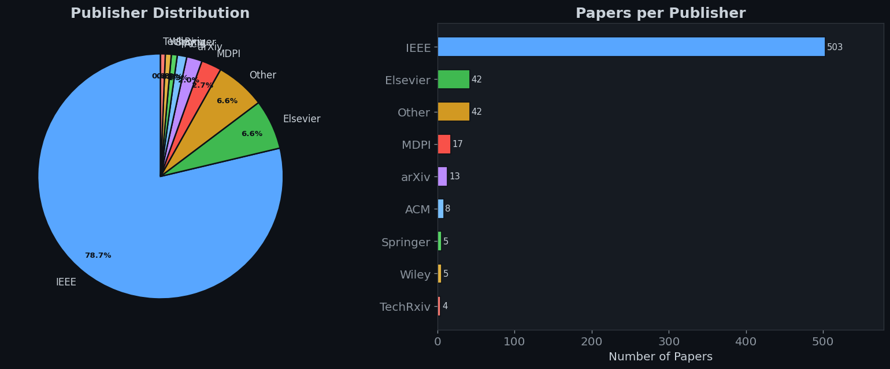
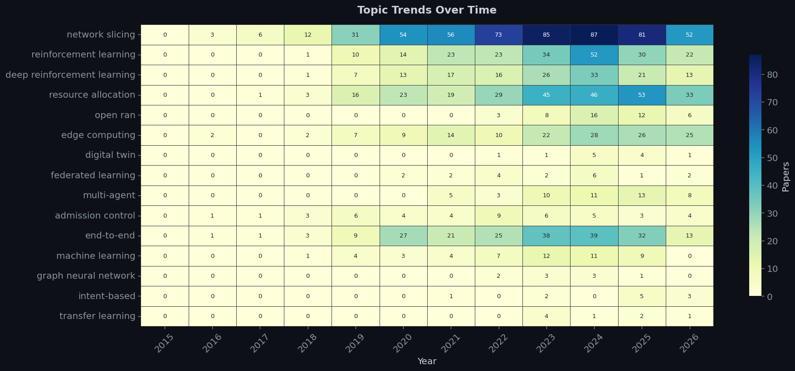
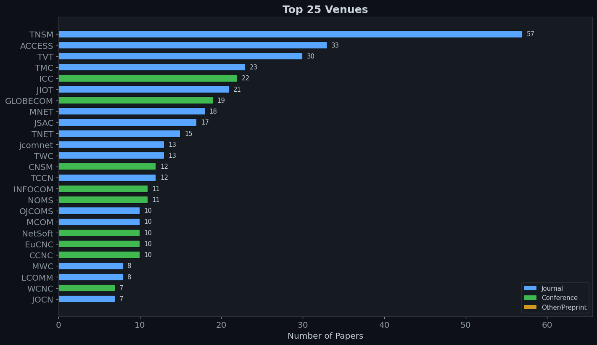

# 📚 Network Slicing Literature Analysis

A toolkit for cataloging, enriching, and analyzing **~650 research papers** on network slicing and resource allocation in 5G/6G networks.


## Overview

This project provides three tools that work together:

1. **`literature_catalog.py`** — Scans a folder of PDF files, parses venue/year/author/title from filenames, and enriches each entry with DOI, abstract, and metadata from Semantic Scholar, CrossRef, and OpenAlex.

2. **`fill_abstracts.py`** — Fills missing abstracts for papers that already have DOIs, querying CrossRef, Semantic Scholar, OpenAlex, and publisher landing pages (IEEE Xplore, ScienceDirect, MDPI, Springer, ACM).

3. **`litreview_dashboard.ipynb`** — Interactive Jupyter dashboard with 11 visualizations covering publisher distribution, publication trends, venue analysis, word clouds, topic heatmaps, and more.

## Sample Outputs

| Publisher Distribution | Topic Trends Heatmap |
|:---:|:---:|
|  |  |

| Word Clouds | Top Venues |
|:---:|:---:|
|  |  |

## Getting Started

### Prerequisites

- Python 3.10+
- A folder of PDF files with filenames following the naming convention (see below)

### Installation

```bash
# Clone the repo
git clone https://github.com/<your-username>/network_slicing_literature_analysis.git
cd network_slicing_literature_analysis

# Create and activate virtual environment
python -m venv lit_venv
# Windows
.\lit_venv\Scripts\Activate.ps1
# macOS/Linux
source lit_venv/bin/activate

# Install dependencies
pip install -r requirements.txt
```

### Usage

#### Step 1: Build the catalog from PDF filenames

Edit the `LITERATURE_DIR` path in `literature_catalog.py` to point to your PDF folder, then run:

```bash
python literature_catalog.py
```

This produces `litreview.csv` with columns: `title_official`, `reference_key`, `venue_acronym`, `year`, `doi`, `abstract`, `first_author`, `filename`.

#### Step 2: Fill missing abstracts

Place `litreview.csv` in the same directory as the script, then:

```bash
python fill_abstracts.py
```

Outputs `litreview_filled.csv` with abstracts populated. Progress is printed live and autosaved every 50 papers.

#### Step 3: Run the dashboard

```bash
jupyter notebook litreview_dashboard.ipynb
```

Run all cells to generate the visualizations.

## PDF Filename Convention

The scripts expect PDF filenames in one of these formats:

```
VENUE YEAR - Paper_Title.pdf
VENUE YEAR AuthorLastName - Paper_Title.pdf
```

Examples:
```
TNSM 24 Liu - RL_Based_Network_Slicing_Scheme_for_Future_Networks.pdf
ICC 23 - 5G_Network_Slicing_for_Mission_Critical_Use_Cases.pdf
PREP 25 Camargo - Towards_Cloud_Native_Agentic_Protocol_Learning.pdf
```

- `PREP` / `Prep` in the venue field denotes preprints — the scripts check whether these have since been published and update accordingly.
- Underscores in titles are automatically converted to spaces.

## Dashboard Sections

| # | Section | Description |
|---|---------|-------------|
| 1 | Publisher Distribution | Pie + bar chart (IEEE, Elsevier, MDPI, Springer, ACM, Wiley, Other) |
| 2 | Publication Timeline | Papers per year with trend line |
| 3 | Journal vs Conference | Pie chart + stacked bar over time |
| 4 | Top 25 Venues | Horizontal bars color-coded by type |
| 5 | Word Clouds | Title keywords, abstract keywords, title bigrams |
| 6 | Top Domain Terms | Compound term frequency (network slicing, DRL, O-RAN, etc.) |
| 7 | Top First Authors | Most prolific first authors in the collection |
| 8 | Topic Trends Heatmap | 15 key topics × years |
| 9 | Venue × Year Bubbles | Top 10 venues activity over time |
| 10 | Length Distributions | Abstract and title word count histograms |
| 11 | Summary Statistics | Aggregate numbers |

## Data Sources

The enrichment scripts query the following free APIs (no API keys required):

- [CrossRef](https://www.crossref.org/) — DOI resolution, abstracts, metadata
- [Semantic Scholar](https://www.semanticscholar.org/) — Paper search, abstracts, author info
- [OpenAlex](https://openalex.org/) — Abstracts (via inverted index), concepts
- Publisher landing pages — IEEE Xplore, ScienceDirect, MDPI, Springer, ACM (HTML scraping)

## Project Structure

```
network_slicing_literature_analysis/
├── literature_catalog.py          # Step 1: PDF filename → CSV catalog
├── fill_abstracts.py              # Step 2: Fill missing abstracts
├── litreview_dashboard.ipynb      # Step 3: Analysis dashboard
├── litreview.csv                  # Raw catalog (input)
├── litreview_filled.csv           # Enriched catalog (output)
├── requirements.txt               # Python dependencies
├── .gitignore
├── *.png                          # Generated figures
└── README.md
```

## License

This project is licensed under the MIT License. See [LICENSE](LICENSE) for details.

## Citation

If you find this toolkit useful for your own literature review, feel free to cite or reference this repository.

## Author

**Sina Ebrahimi**
PhD Candidate, Centre for Future Transport and Cities (CFTC), Coventry University
Research focus: 5G/6G End-to-End Network Slicing, Multi-Agent Deep Reinforcement Learning
